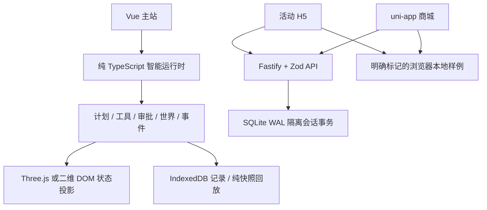

# V2 架构与工程取舍

保留三个 Vue/TypeScript 应用与基线 `b62db8d` 的既有路由。根 workspace 与 uni-app 各有锁文件；构建汇总保留 `/`、`/shop/`、`/pulse/` 和仓库子路径。没有为了图形引擎重新换框架。

| 区域                       | 责任                                                               |
| -------------------------- | ------------------------------------------------------------------ |
| apps/portfolio             | 首页、案例、文章、智能台、回放、企业仿真与实验 UI                  |
| packages/intelligence/src  | 无 Vue/Three 依赖的状态机、工具模拟、A\*、世界版本、事件与回放校验 |
| apps/campaign-h5/src/v2    | 同源 Cookie 客户端、偏好/预约/恢复                                 |
| apps/commerce-mini/src/v2  | uni.request 跨端客户端、Bearer 会话、报价/订单                     |
| packages/shared/src/api.ts | 线协议、整数分、规则版本、可解释推荐                               |
| services/demo-api/src      | 权威业务约束、事务、权限、幂等、重启持久化                         |
| tests/e2e                  | 生产包业务流程、真实 API、宽度与降级验收                           |

## 运行时与图形

状态机是事实，渲染是投影。图形完成不会触发业务成功。动作检查世界版本、路径合法与可行走性；障碍使旧路径失效。取消/重置隔离迟到结果；人工批准和后续写入是两个动作。回放只投影经版本、序号、内容与尺寸校验的历史快照，不重发工具。

Three 按路由懒加载，当前独立图形 chunk 约 531 kB 未压缩、134 kB gzip，仍保留 Vite 大包提醒；首页不加载它。DPR≤1.5、绘制像素≤160万；后台暂停，context loss 降到二维，卸载释放几何/材质/renderer。10 次真实浏览器卸载重挂已验证。

商品/活动工具使用合成数据；真实模型模式未配置。机器人感知为模拟器状态读取，没有训练视觉模型、控制实体设备或实现 AGI。

## API、并发与恢复

每次写入在 SQLite BEGIN IMMEDIATE 内校验会话、版本、规则和幂等指纹，再一并保存业务变化与响应副本。相同 key 和内容返回首次不可变结果；不同内容冲突；失败回滚。

客户端先保存原 key/body，超时保留 UNKNOWN，先查询再用原 key 重试。身份丢失不创建新会话重发；明确放弃先将未知请求有界归档，不能据此断言原动作没发生。详见 [客户端恢复](docs/architecture/CLIENT_RECOVERY.md)。

数据库是按会话分隔的小型 JSON 文档，事务规则在 TypeScript 实现，并非规范化商业数据库；读取也写回时间刷新的文档。同步 SQLite、单进程、隔离库存是适合本地展示的取舍，不声明多实例、高吞吐或生产规模。见 [数据与状态](docs/architecture/DATA_AND_STATE.md)。

## 发布与内容边界

Pages 仅静态托管；API 默认回环监听，无宽泛 CORS。未来公网服务需精确来源、HTTPS/Secure Cookie、持久卷、容量监控和恢复演练，不能把静态构建当成服务上线。

金融回放只计算已到达前缀；Worker 用代际拒绝旧查询；企业仿真独立演示审批/库存/结算，不复制私有 Java 代码。系统字体无 CDN，图形和商品/活动插图为本仓原创代码；历史证据保留来源与状态。安全扫描不替代人工审阅或依赖审计。
