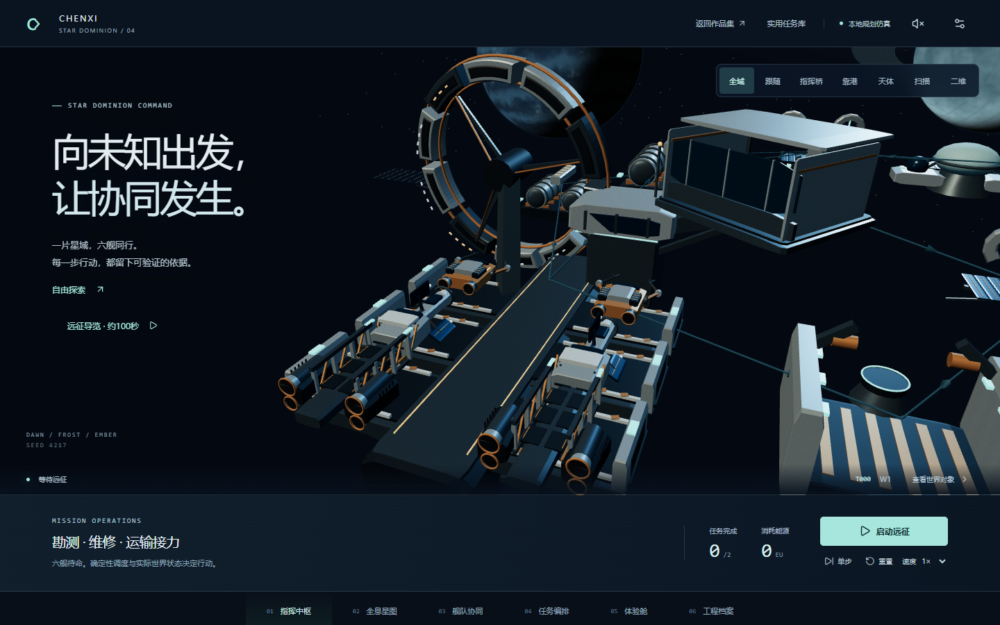

# Chenxi DevLab · 星域智航 V4

**从业务问题到工程交付。运行作品，打开源码，核对证据。**

唯一开发与发布仓库：[Callmecx/chenxi-devlab-2026](https://github.com/Callmecx/chenxi-devlab-2026)。沿用 Vue 3、TypeScript、Vite、Three.js 与独立 uni-app 工程。V4 将智能实验室扩展为三类六舰、四条任务链的星际协同指挥中枢；商城、H5、金融回放、企业仿真与本机持久化 API 保持独立。

[主站](https://callmecx.github.io/chenxi-devlab-2026/#/) · [智能演化实验室](https://callmecx.github.io/chenxi-devlab-2026/#/intelligence) · [巷集商城](https://callmecx.github.io/chenxi-devlab-2026/shop/#/) · [蓉城周末 H5](https://callmecx.github.io/chenxi-devlab-2026/pulse/#/)。准确发布版本见 [STATUS.md](STATUS.md)。

点击“启动远征”，观察勘测、维修与运输的真实依赖。关闭航道、制造不可达、重新开放并显式重试；暂停后从同一快照实算两个未来，采用只改变后续策略。镜头、装卸、扫描与维修显示来自真实世界状态，动画不能宣布任务完成。“远征导览”可随时接管，导出记录可严格验证后只读回放。

[V4 架构与世界规则](docs/intelligence-lab-v4/ARCHITECTURE.md) · [模式与发布状态](docs/intelligence-lab-v4/MODE_AND_RELEASE_STATUS.md) · [三分钟演示及源码追问](docs/intelligence-lab-v4/DEMO_GUIDE.md) · [功能与贡献映射](docs/intelligence-lab-v4/CONTRIBUTION_MAP.md) · [A/B 简历条目](docs/intelligence-lab-v4/RESUME_BULLETS.md)。当前验收和公开版本以 [STATUS](STATUS.md) 为准。



[六态原图、手机与V3对照](docs/intelligence-lab-v4/VISUAL_REVIEW.md) · [本轮测试](docs/intelligence-lab-v4/TEST_REPORT.md) · [性能实测](docs/intelligence-lab-v4/PERFORMANCE.md) · [可导入的合成运行记录](docs/intelligence-lab-v4/guide-example.json)。本地干净源码3c6d78f通过399项单元/API、127项生产浏览器与50轮生命周期检查；原始导览100.480秒。CI与实际部署独立记账，不用本地成绩代替上线结论。

[V3 历史运行入口](https://callmecx.github.io/chenxi-devlab-2026/#/intelligence/v3)与[V3 原始验收记录](docs/intelligence-lab-v3/ACCEPTANCE_REPORT.md)保留；旧版截图、标签和测试不会冒充 V4 的本轮证据。

## 可以实际操作的内容

| 作品                | 本轮实现                                                                                                           | 运行边界                                                                   |
| ------------------- | ------------------------------------------------------------------------------------------------------------------ | -------------------------------------------------------------------------- |
| 星域智航 V4         | 原创三域、11站16路、三类六舰、补给/接力/救援/采样任务、资格/资源/泊位约束、六共享视图、五种体验、四策略Worker分支与严格回放 | 本地确定性算法和受控规划替身；无在线模型或实体航天验证；启发式调度不宣称全局最优 |
| 实用任务库          | 商品/活动目标、参数/结果/来源/耗时、审批/取消/失败/重试、原仓库 A\* 与回放                                         | 保留于 `/intelligence/tasks`；模拟数据和本地草稿；AGI 为愿景               |
| 巷集 Select         | 12 SPU/25 SKU/4 分类、SKU、购物车、优惠券、服务端报价/库存预留、模拟付款/履约、未知结果查询和恢复                  | Pages 默认本地模式；可信 API 模式须启动本机服务；没有真实支付              |
| 蓉城周末 Lab        | 偏好推荐、路线/场次、名额检查、预约结果、查询取消、异常和丢响应恢复                                                | 公开本地样例与本机持久 API 明确分开；数据为模拟                            |
| Market Replay Lab   | 合成事件播放/单步/速度/时间线、只读已到达前缀、缺口冻结回补、去重、切换取消                                        | 非实盘、收益回测；旧 Rust 项目历史问题保留                                 |
| EnterpriseFlow 仿真 | 审批→采购→收货→出库→分次结算、非法动作约束、幂等重放                                                               | 独立原创仿真，未复制或修改旧 Java 私有系统                                 |
| 三项工程实验        | 两角色争最后库存、已提交丢响应的恢复、10 万行 Worker 查询与虚拟列表                                                | 库存/恢复实验连接本机 API；大列表可公开本地运行                            |

## 本地运行

Node.js 24，根与 uni-app 保留两套锁文件：

```powershell
npm ci
npm ci --prefix apps/commerce-mini
npm run dev:api
```

另开终端运行 `npm run dev`、`npm run dev:pulse` 或 `npm run dev:shop`。端口以输出为准。API 默认 4016，SQLite 默认 `.local/data/demo.sqlite`；运行数据和凭据不进入 Git。

完整生产预览：

```powershell
npm run build
npm run preview
```

打开 `http://127.0.0.1:4173/`、`/shop/`、`/pulse/`。预览代理 `/api/v1/` 到 API。页面选择“服务端演示”并连接后才进入 API 模式，失败明确提示，不静默退回本地。服务端数据按 24 小时演示会话隔离，丢失身份后不能换新身份重发旧订单。

## 验证与证据

```powershell
npm run typecheck
npm run lint
npm test
npm run build
npm run build:mini
npm run build:app
# 本机使用已安装 Chrome；录像工具放在当前 D 盘工作区
$env:PLAYWRIGHT_BROWSERS_PATH = Join-Path (Get-Location) '.local/playwright'
npx playwright install ffmpeg
npm run test:e2e
npm run test:summary
node scripts/evaluate-intelligence.ts
node scripts/benchmark-api.ts
# V4生产截图/无剪辑导览（要求干净源码构建，输出到忽略的.local/v4）
node scripts/capture-dominion.mjs http://127.0.0.1:4173/
# 同硬件V3/V4对比；先保留V3生产包到.local/v4/baseline/production-dist
node scripts/measure-dominion.mjs
npm run security:scan
```

V4测试与发布按G0—G6分别记账，最终结果见[STATUS](STATUS.md)。升级前已重新跑通干净V3的308项单元/API和95项浏览器基线。原V3浏览器断言保留，仅将历史场景导航到 `/intelligence/v3`；新V4业务、故障、导览和生命周期用例覆盖正式 `/intelligence`。不会把编写了用例、构建成功或历史通过数当成本轮验收。V3旧发布记录保留于[原验收报告](docs/intelligence-lab-v3/ACCEPTANCE_REPORT.md)。

E2E 使用独立 4116 API、4176 预览与 `.local/e2e/demo.sqlite`，不复用未知服务。CI 使用 Chromium。截图在 `docs/screenshots/`，原始录像/trace 留在忽略的 `.local/e2e/`；公开摘要不包含会话凭据或机器私密路径。

- [架构](ARCHITECTURE.md) / [设计系统](DESIGN_SYSTEM.md) / [V2历史性能](PERFORMANCE_REPORT.md) / [V3动态性能](docs/intelligence-lab-v3/PERFORMANCE_REPORT.md)
- [智能评测](docs/intelligence-lab/EVALUATION_REPORT.md) / [能力与模式](docs/intelligence-lab/CAPABILITY_AND_MODE_MATRIX.md)
- [API 契约](docs/upgrade/API_CONTRACT.md) / [数据库与状态](docs/architecture/DATA_AND_STATE.md)
- [客户端恢复](docs/architecture/CLIENT_RECOVERY.md) / [跨端验收](docs/acceptance/PLATFORM_RELEASE_MATRIX.md)
- [功能—源码—测试—演示—简历映射](docs/interview/FEATURE_SOURCE_TEST_DEMO_RESUME.md)
- [面试演示](docs/interview/DEMO_GUIDE.md) / [简历 A 项目段落](docs/interview/RESUME_A_PROJECTS.md) / [简历 B 项目段落](docs/interview/RESUME_B_PROJECTS.md)
- [10分钟四作品路线与源码追问](docs/interview/FLAGSHIP_WALKTHROUGH.md) / [开发资源与SHA256](docs/acceptance/RESOURCE_ARTIFACTS.md)
- [实际发布提交、CI与匿名线上复验](DEPLOYMENT_REPORT.md)

## 发布边界

Pages 仅托管静态应用和脱敏证据，不能运行 Fastify/SQLite。当前没有已批准公网 API 地址；生产服务仍需要 HTTPS、精确 Origin、Secure Cookie、持久卷和监控等独立验收。

微信构建为开发资源、游客 AppID；App 构建为 HBuilderX 输入资源。均不等于真机通过、APK/IPA、审核或上架。未付费调用模型、购买服务或公开客户数据。

开发采用 AI 协作，以实际源码和证据核对描述。历史私有源码、真实客户/支付/交易数据和凭据未合入。联系：[GitHub @Callmecx](https://github.com/Callmecx) · [496684212@qq.com](mailto:496684212@qq.com)。
