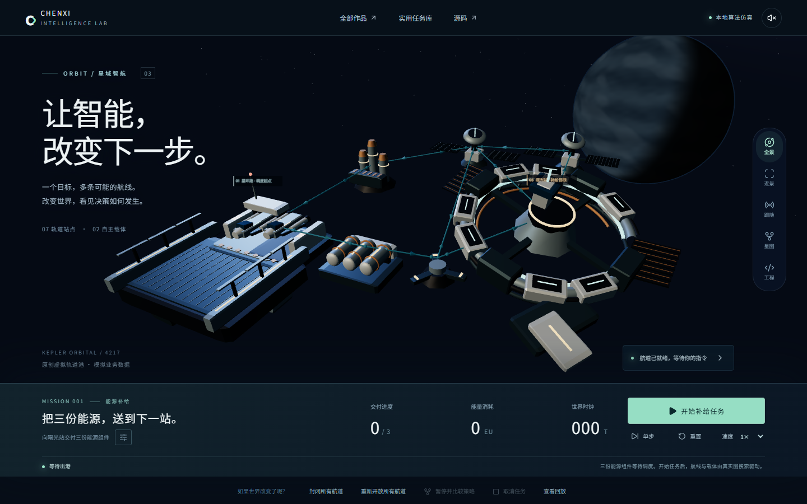

# Chenxi DevLab · 星域智航 V3

**从业务问题到工程交付。运行作品，打开源码，核对证据。**

唯一开发与发布仓库：[Callmecx/chenxi-devlab-2026](https://github.com/Callmecx/chenxi-devlab-2026)。沿用 Vue 3、TypeScript、Vite、Three.js 与独立 uni-app 工程。V3 将智能实验室重构为可干预的轨道港，同时保留商城、H5、金融回放、企业仿真和本机持久化 API。

[主站](https://callmecx.github.io/chenxi-devlab-2026/#/) · [智能演化实验室](https://callmecx.github.io/chenxi-devlab-2026/#/intelligence) · [巷集商城](https://callmecx.github.io/chenxi-devlab-2026/shop/#/) · [蓉城周末 H5](https://callmecx.github.io/chenxi-devlab-2026/pulse/#/)。准确发布版本见 [STATUS.md](STATUS.md)。



点击“开始补给任务”，观察两艘载体取送三份能源。关闭航道、制造不可达、重新开放并恢复；从同一暂停快照比较时效/能耗策略；在工程视图核对输入输出和事件，再回放实际过程。结果由世界状态与约束判定，不由动画结束判定。

[V3 验收矩阵](docs/intelligence-lab-v3/ACCEPTANCE_REPORT.md) · [世界规则](docs/intelligence-lab-v3/WORLD_RULES.md) · [状态与渲染边界](docs/intelligence-lab-v3/RUNTIME_CONTRACT.md) · [前后视觉评审](docs/intelligence-lab-v3/VISUAL_REVIEW.md) · [动态性能实测](docs/intelligence-lab-v3/PERFORMANCE_REPORT.md) · [实际操作录屏](docs/intelligence-lab-v3/VIDEO.md) · [三分钟演示与简历建议](docs/intelligence-lab-v3/DEMO_GUIDE.md)。最终验收和公开版本以 [STATUS](STATUS.md) 为准。

## 可以实际操作的内容

| 作品                | 本轮实现                                                                                                           | 运行边界                                                                   |
| ------------------- | ------------------------------------------------------------------------------------------------------------------ | -------------------------------------------------------------------------- |
| 星域智航 V3         | 原创轨道港、7站9路、双载体预约、库存/容量/能量约束、封路重规划、同源Worker分支、严格历史校验、3D/2D/手机与减弱动效 | 本地确定性算法；无模型在线、视觉训练或实体机器人；启发式调度不宣称全局最优 |
| 实用任务库          | 商品/活动目标、参数/结果/来源/耗时、审批/取消/失败/重试、原仓库 A\* 与回放                                         | 保留于 `/intelligence/tasks`；模拟数据和本地草稿；AGI 为愿景               |
| 巷集 Select         | 12 SPU/25 SKU/4 分类、SKU、购物车、优惠券、服务端报价/库存预留、模拟付款/履约、未知结果查询和恢复                  | Pages 默认本地模式；可信 API 模式须启动本机服务；没有真实支付              |
| 蓉城周末 Lab        | 偏好推荐、路线/场次、名额检查、预约结果、查询取消、异常和丢响应恢复                                                | 公开本地样例与本机持久 API 明确分开；数据为模拟                            |
| Market Replay Lab   | 合成事件播放/单步/速度/时间线、只读已到达前缀、缺口冻结回补、去重、切换取消                                        | 非实盘、收益回测；旧 Rust 项目历史问题保留                                 |
| EnterpriseFlow 仿真 | 审批→采购→收货→出库→分次结算、非法动作约束、幂等重放                                                               | 独立原创仿真，未复制或修改旧 Java 私有系统                                 |
| 三项工程实验        | 两角色争最后库存、已提交丢响应的恢复、10 万行 Worker 查询与虚拟列表                                                | 库存/恢复实验连接本机 API；大列表可公开本地运行                            |

## 本地运行

Node.js 24，根与 uni-app 保留两套锁文件：

```powershell
npm ci
npm ci --prefix apps/commerce-mini
npm run dev:api
```

另开终端运行 `npm run dev`、`npm run dev:pulse` 或 `npm run dev:shop`。端口以输出为准。API 默认 4016，SQLite 默认 `.local/data/demo.sqlite`；运行数据和凭据不进入 Git。

完整生产预览：

```powershell
npm run build
npm run preview
```

打开 `http://127.0.0.1:4173/`、`/shop/`、`/pulse/`。预览代理 `/api/v1/` 到 API。页面选择“服务端演示”并连接后才进入 API 模式，失败明确提示，不静默退回本地。服务端数据按 24 小时演示会话隔离，丢失身份后不能换新身份重发旧订单。

## 验证与证据

```powershell
npm run typecheck
npm run lint
npm test
npm run build
npm run build:mini
npm run build:app
# 本机使用已安装 Chrome；录像工具放在当前 D 盘工作区
$env:PLAYWRIGHT_BROWSERS_PATH = Join-Path (Get-Location) '.local/playwright'
npx playwright install ffmpeg
npm run test:e2e
npm run test:summary
node scripts/evaluate-intelligence.ts
node scripts/benchmark-api.ts
node scripts/measure-orbit.mjs http://127.0.0.1:4173/
npm run security:scan
```

V3 已实际通过 308 项单元/接口测试（其中61项为新增轨道港领域测试）。2026-10-13 01:47:59.688（Asia/Shanghai）开始的 `da9b633` 本机生产包完整回归 **95/95** 通过，耗时296.929秒（约4分56.9秒），零失败、跳过和重试；包含原全站64项、旗舰28项和Worker故障恢复3项。远端[PR CI](https://github.com/Callmecx/chenxi-devlab-2026/actions/runs/38281209887)与[主分支CI/Pages](https://github.com/Callmecx/chenxi-devlab-2026/actions/runs/38286209858)均已通过；2026/10/13 02:02:26（Asia/Shanghai）匿名浏览器复验了实际提交`da9b6337be81f7d6650785071984d1d2eb73fb47`，9路由×2视口、4业务流程、4证据资产，页面错误和失败资产均为0。详见[部署报告](DEPLOYMENT_REPORT.md)。性能、历史93项及94项记录与发布结果见 [TEST_REPORT.md](TEST_REPORT.md) 和 V3 验收报告。V2 的247项单元/接口、64项浏览器和450个评测场景作为历史证据保留，不代替 V3 验收。

E2E 使用独立 4116 API、4176 预览与 `.local/e2e/demo.sqlite`，不复用未知服务。CI 使用 Chromium。截图在 `docs/screenshots/`，原始录像/trace 留在忽略的 `.local/e2e/`；公开摘要不包含会话凭据或机器私密路径。

- [架构](ARCHITECTURE.md) / [设计系统](DESIGN_SYSTEM.md) / [V2历史性能](PERFORMANCE_REPORT.md) / [V3动态性能](docs/intelligence-lab-v3/PERFORMANCE_REPORT.md)
- [智能评测](docs/intelligence-lab/EVALUATION_REPORT.md) / [能力与模式](docs/intelligence-lab/CAPABILITY_AND_MODE_MATRIX.md)
- [API 契约](docs/upgrade/API_CONTRACT.md) / [数据库与状态](docs/architecture/DATA_AND_STATE.md)
- [客户端恢复](docs/architecture/CLIENT_RECOVERY.md) / [跨端验收](docs/acceptance/PLATFORM_RELEASE_MATRIX.md)
- [功能—源码—测试—演示—简历映射](docs/interview/FEATURE_SOURCE_TEST_DEMO_RESUME.md)
- [面试演示](docs/interview/DEMO_GUIDE.md) / [简历 A 项目段落](docs/interview/RESUME_A_PROJECTS.md) / [简历 B 项目段落](docs/interview/RESUME_B_PROJECTS.md)
- [10分钟四作品路线与源码追问](docs/interview/FLAGSHIP_WALKTHROUGH.md) / [开发资源与SHA256](docs/acceptance/RESOURCE_ARTIFACTS.md)
- [实际发布提交、CI与匿名线上复验](DEPLOYMENT_REPORT.md)

## 发布边界

Pages 仅托管静态应用和脱敏证据，不能运行 Fastify/SQLite。当前没有已批准公网 API 地址；生产服务仍需要 HTTPS、精确 Origin、Secure Cookie、持久卷和监控等独立验收。

微信构建为开发资源、游客 AppID；App 构建为 HBuilderX 输入资源。均不等于真机通过、APK/IPA、审核或上架。未付费调用模型、购买服务或公开客户数据。

开发采用 AI 协作，以实际源码和证据核对描述。历史私有源码、真实客户/支付/交易数据和凭据未合入。联系：[GitHub @Callmecx](https://github.com/Callmecx) · [496684212@qq.com](mailto:496684212@qq.com)。
