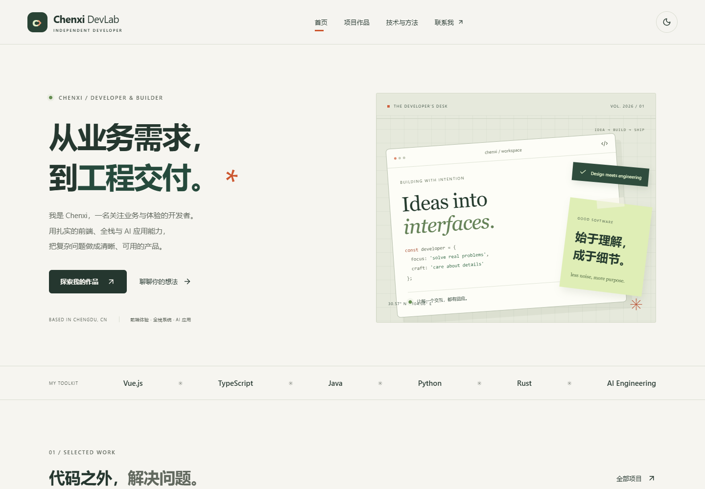

# Chenxi DevLab

**从业务需求到工程交付｜AI 应用、全栈系统与前端体验**

一个原创个人开发者品牌站，以及两个有真实本地业务逻辑的前端作品：ShopPilot 电商 H5 / uni-app 小程序、PulseCampaign 活动预约 H5。三个应用独立开发、独立构建；演示数据、Mock 行为和历史项目边界均明确标注。

公开仓库：[Callmecx/chenxi-devlab-2026](https://github.com/Callmecx/chenxi-devlab-2026)。

**在线体验：[个人主站](https://callmecx.github.io/chenxi-devlab-2026/) · [ShopPilot](https://callmecx.github.io/chenxi-devlab-2026/shop/) · [PulseCampaign](https://callmecx.github.io/chenxi-devlab-2026/pulse/)**

2026-10-12 已完成 GitHub Pages 发布，三个入口均通过线上 Chrome 检查。部署与复核证据见 [DEPLOYMENT_REPORT.md](DEPLOYMENT_REPORT.md)。

本仓库不包含既有客户数据、私有项目源码、真实支付、交易执行或模型凭据。联系：[GitHub @Callmecx](https://github.com/Callmecx) · [496684212@qq.com](mailto:496684212@qq.com)（本人授权公开）。



查看 [ShopPilot 桌面截图](docs/screenshots/shop-desktop.png)、[PulseCampaign 移动截图](docs/screenshots/pulse-mobile.png) 与[全部验收截图](docs/screenshots)。

## 本地开始

使用 Node.js 24 与 npm。根 workspace 和 uni-app 工程使用独立锁文件，均需要安装：

```powershell
npm ci
npm --prefix apps/commerce-mini ci
```

分别启动：

```powershell
npm run dev
npm run dev:pulse
npm run dev:shop
```

以命令输出的本机地址为准。要同时体验汇总后的三个应用：

```powershell
npm run build
npm run preview
```

默认本地预览为 `http://127.0.0.1:4173/`，两个作品入口是 `/shop/` 和 `/pulse/`。此地址仅为本地预览，不是公网发布地址。

## 展示内容

| 应用 | 功能 |
|---|---|
| 主站 | 原创响应式设计、深浅主题、技术能力分层、七项项目案例、详情与证据、联系入口 |
| ShopPilot | 分类/搜索/筛选、SKU 与库存、购物车增减删除勾选、优惠券和整数分金额、演示地址、重复提交保护、模拟订单状态、历史和本地持久化 |
| PulseCampaign | 原创活动首页、详情、交互选场、多步骤预约、时间冲突与名额校验、草稿恢复、模拟失败与重试、成功回执、取消和本地统计 |

建议现场演示：ShopPilot 选择规格 → 加入购物车 → 使用优惠券 → 选择演示地址 → 提交订单 → 推进订单状态；PulseCampaign 选场 → 尝试冲突时段 → 填写虚构昵称 → 模拟失败 → 重试成功 → 取消预约。两个作品都不需要账号、Key 或真实个人信息。

## 验证

```powershell
npm run typecheck
npm run lint
npm test
npm run build
npm run build:mini
npm run test:e2e
npm run security:scan
```

本机测试默认使用已安装 Chrome；CI 使用 Playwright Chromium，运行 `npx playwright install --with-deps chromium` 安装。2026-10-12 实测：35/35 单元与状态测试、17/17 浏览器测试、全部类型检查/Lint/构建通过。测试范围和限制见 [TEST_REPORT.md](./TEST_REPORT.md)。

微信构建输出为 `apps/commerce-mini/dist/build/mp-weixin`。项目配置使用游客 AppID，仅用于开发者工具导入与编译实践；不表示微信审核或正式上线。

## 项目说明

- [架构与技术取舍](./ARCHITECTURE.md)
- [项目展示与面试演示](./PROJECT_SHOWCASE.md)
- [可用于简历的真实描述](./RESUME_PROJECT_HIGHLIGHTS.md)
- [测试报告](./TEST_REPORT.md)
- [真实 Lighthouse 性能报告](./PERFORMANCE_REPORT.md)
- [安全审查与依赖审计](./docs/testing/SECURITY_REVIEW.md)
- [既有项目证据与公开边界](./docs/research/PROJECT_EVIDENCE.md)

旧案例包含 EnterpriseFlow、AI Agent Workbench、PokerReplay、Solana Radar 与 Rust 链上事件工具。公开源码入口与历史测试分别核实；未获得公开授权的源码和客户数据保持在原项目中。本轮没有修改这些旧工程。

## 静态发布

`BASE_PATH` 指定项目级部署路径，例如 PowerShell 设置 `$env:BASE_PATH='/your-repository/'` 后运行构建。汇总产物在 `dist/`，不包含服务器端业务进程。

GitHub Actions 自动安装两套锁定依赖、检查类型与 Lint、执行单元/浏览器测试、构建 H5/小程序、扫描发布文件，再发布 GitHub Pages。小程序构建和测试证据作为 Actions artifacts 保留。CI 安装 CJK 字体，确保中文浏览器截图可读。

本地模拟状态仅保存在当前浏览器；没有真实支付、服务器可信库存、多端同步或商业客户规模。开发采用 AI 协同，项目叙述与验收坚持以实际代码和可复现证据为准。
