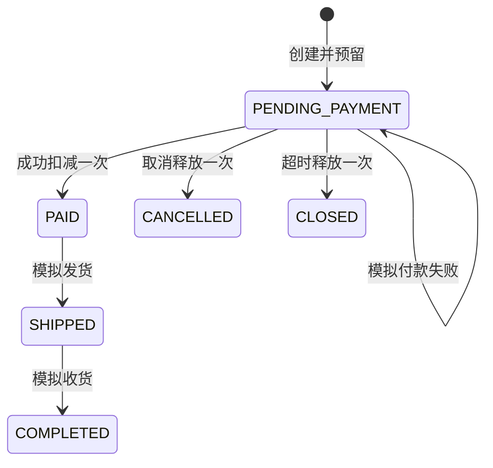

# 持久数据、约束与状态机

实现位于 `services/demo-api/src/database.ts`，使用 Node 24 原生 node:sqlite。数据库在忽略的 .local，不提交。版本 1 初始化以下结构与索引，重启复用数据：

```sql
CREATE TABLE sessions (
  token_hash TEXT PRIMARY KEY,
  domain TEXT NOT NULL,
  expires_at INTEGER NOT NULL,
  state TEXT NOT NULL
);
CREATE INDEX sessions_expiry ON sessions(expires_at);
PRAGMA journal_mode=WAL;
PRAGMA busy_timeout=5000;
PRAGMA user_version=1;
```

state 保存该会话独立的 products/cart/coupons/quotes/orders/slots/bookings/operations/races 文档。令牌随机生成，仅存 SHA-256；domain 参与查询。会话 24 小时到期，新建时清理过期记录并限制 500 会话。只有初始迁移；未来更改先检查版本、停写备份，再执行逐版迁移，不能直接重置数据库。

## 实际约束位置

Zod 校验严格对象、整数和版本；TypeScript 业务函数在 SQLite BEGIN IMMEDIATE 内检查库存、预留、席位、金额和状态；主键提供会话唯一性。未声称 JSON 子字段有 SQL CHECK/FK。错误回滚，幂等响应和业务同事务提交，响应保存深拷贝。

| 数据   | 规则                                                               |
| ------ | ------------------------------------------------------------------ |
| 金额   | 整数分；服务端重算价格/优惠/运费，拒绝直接传总价                   |
| 购物车 | 整车版本比较；规格1–5件、最多20规格，只清除选中行                  |
| 报价   | 120秒；记录条目/地址/券/规则，不占库存                             |
| 订单   | 待付15分钟，创建时再次校验并预留；成功扣一次、取消/超时释放一次    |
| 优惠券 | AVAILABLE→HELD→USED；取消/到期恢复，不能重复消费                   |
| 预约   | 同会话同活动仅一有效预约、1–4人；服务端时间检查开放/截止/规则/席位 |
| 取消   | 用户取消限截止前；活动取消释放；重复不二次释放，结束保留历史人数   |
| 幂等   | 同会话/domain/key/path/body返回同响应；冲突409；最多1500操作       |



预约 CONFIRMED→USER_CANCELLED/ACTIVITY_CANCELLED/EXPIRED。访问事务进行时间刷新，无独立定时调度器。两个访客隔离；库存实验让两角色在同一隔离会话竞争一件库存，以实际事务验证冲突。

## 重启与备份

接口测试实际启动 HTTP、写盘、关闭服务并重开同一个 SQLite，核验订单、预约与幂等持久性。备份应先停止该专用 API、确认连接关闭，再复制数据库及仍存在的 WAL/SHM 到私有备份目录；在副本上恢复验证。运行数据不上传 GitHub/Pages。

当前不支持高吞吐、多实例或跨设备身份恢复；丢失令牌只能保留/归档未知请求，不能找回旧身份或保证动作未发生。公开商业服务需要进一步身份、账务、防滥用、迁移与恢复设计。
