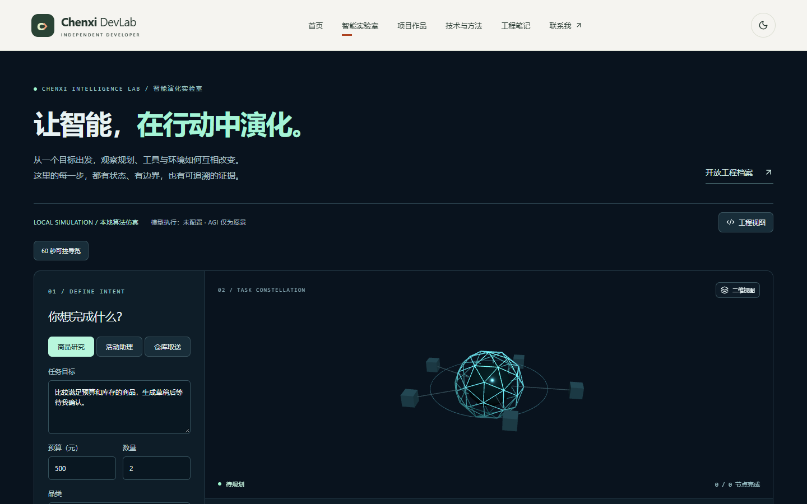
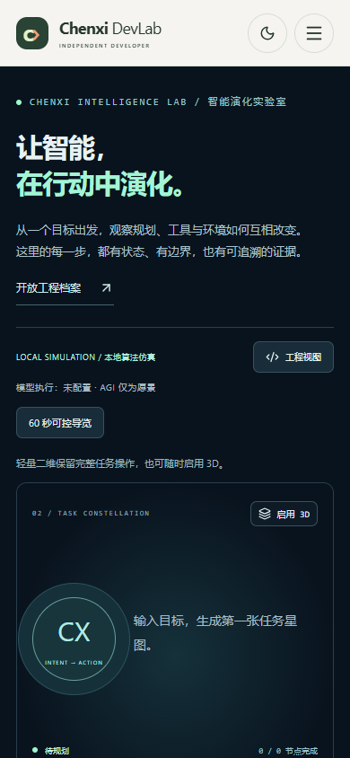

# 星域智航 V3：V2 真实视觉基线

基线提交：`8059fb954e089a7880a4d1cea52941f03deb5c54`（`8059fb9`）。本轮只采集并审阅既有 V2，没有将它改名后当作 V3 成果。

## 指令与评价来源

已完整阅读用户附件 `Chenxi_Intelligence_Lab_V3_星域智航_视觉交互重构指令_20261012.md`。附件记录用户对当前实验室的评价为 **3/10**，指出左侧大表单、中央小线框球与少量方块、空白占主导。本报告保留这个用户反馈，不把它说成审阅者重新打出的分数。

本轮没有收到可读取的用户图片附件，也没有声称看过用户未提供的图片。以下视觉观察全部来自本机当前 V2 的真实浏览器截图；不是概念图、生成图或竞品截图。

## 采集条件与范围

- 页面：本机生产预览 `http://127.0.0.1:4173/#/intelligence`。
- 浏览器：桌面 Chrome `154.0.8037.94`，headless，DPR 1，`prefers-reduced-motion: no-preference`；每个视口使用新的浏览器上下文。
- 有效采集区间：2026-10-12 23:18:37 至 23:20:29（Asia/Shanghai）。桌面和手机分批完成，构建元信息前后相同。
- 页面 `build-meta.json` 的 `sourceRevision` 与上述基线提交一致；构建时间为 `2026-10-12T14:20:52.510Z`，基址 `/`。
- 实际 V2 默认行为：桌面为 3D，手机为 2D。桌面另外通过“二维视图”按钮捕获 2D，文件名中的 `selected` 不表示桌面默认二维。
- 14 张原始 PNG，包含首屏和整页；没有裁掉导航、表单、空白或折叠区域来美化基线。手机另存对场景执行 `scrollIntoViewIfNeeded` 后的视口，不作为默认首屏替代。
- 4 个有效上下文的原始短录屏保留在 `.local/v3/baseline/videos/`，文件映射见 `.local/v3/baseline/manifest.json`。只录制基线浏览、桌面切二维、选择商品研究和一次单步，不是最终要求的 60–120 秒 V3 完整任务影片；录像不提交、不上传。
- 采集脚本位于 `.local/v3/capture-before.mjs`，临时浏览器数据、录像、清单均在 D 盘忽略目录。前两次脚本尝试分别因未先生成计划而点到禁用单步、手机标题换行的选择器不匹配停止；修正采集流程后补齐，不把脚本选择器问题报成页面业务失败。原始尝试记录留在忽略目录，有效文件以清单为准。

四个有效上下文未记录页面 JS 错误或 HTTP 400+ 资源响应，所测 `scrollWidth - innerWidth` 均为 0。这只说明本次采集的加载和宽度情况，不构成视觉通过、业务全流程复验、性能或手机真机验收。

## 截图索引

| 视口        | 默认首屏                                                                  | 默认整页                                                               | 额外视图                                                                                                                                        |
| ----------- | ------------------------------------------------------------------------- | ---------------------------------------------------------------------- | ----------------------------------------------------------------------------------------------------------------------------------------------- |
| 1440 × 900  | [桌面默认 3D](../screenshots/v3/before-1440x900-3d-default-viewport.png)  | [默认 3D 整页](../screenshots/v3/before-1440x900-3d-default-full.png)  | [选择 2D 首屏](../screenshots/v3/before-1440x900-2d-selected-viewport.png)、[2D 整页](../screenshots/v3/before-1440x900-2d-selected-full.png)   |
| 1920 × 1080 | [桌面默认 3D](../screenshots/v3/before-1920x1080-3d-default-viewport.png) | [默认 3D 整页](../screenshots/v3/before-1920x1080-3d-default-full.png) | [选择 2D 首屏](../screenshots/v3/before-1920x1080-2d-selected-viewport.png)、[2D 整页](../screenshots/v3/before-1920x1080-2d-selected-full.png) |
| 390 × 844   | [手机默认 2D](../screenshots/v3/before-390x844-2d-default-viewport.png)   | [默认 2D 整页](../screenshots/v3/before-390x844-2d-default-full.png)   | [场景视口](../screenshots/v3/before-390x844-2d-stage.png)                                                                                       |
| 360 × 800   | [手机默认 2D](../screenshots/v3/before-360x800-2d-default-viewport.png)   | [默认 2D 整页](../screenshots/v3/before-360x800-2d-default-full.png)   | [场景视口](../screenshots/v3/before-360x800-2d-stage.png)                                                                                       |

桌面默认第一帧：

手机默认第一帧：

## 独立视觉观察：作为 V3 的必须改进项

这部分依据真实截图，不用既有测试数量或零控制台错误替代美术与操作评价。

| 项目           | 已观察到的 V2 状态                                                                                                                | 对 V3 的具体复核要求                                                                                       |
| -------------- | --------------------------------------------------------------------------------------------------------------------------------- | ---------------------------------------------------------------------------------------------------------- |
| 第一帧与层次   | 桌面浅色全站导航占顶部；标题、说明、模式、导览纵向排布后，场景从约页面中部才开始。1440 × 900 首屏看不到执行按钮。                 | 使用实验室专属轻导航；第一帧须见完整主场景、一个清晰的开始动作和可识别对象，不能靠空 Canvas 面积完成占比。 |
| 原创形体和尺度 | 主体是小型青色线框球与周围深色方块。1920 × 1080 时内容仍聚在中部，形体没有随可视空间建立近中远关系。                              | 近景港口、中景站点/载体、远景行星应各有尺寸和轮廓；不看说明也能分辨对象用途，不能只放大球体。              |
| 材质与光照     | 线条与发光中心较亮，方块低对比；没有明确金属/冷白/灯带层次，也没有能解释空间体积的主光与轮廓关系。                                | 用实体结构、分色材质和明确光向建立体积；信息青色、故障琥珀与环境色应有分工，发光不遮住形体。               |
| 任务可开始性   | 初始“待规划 / 0 / 0 节点完成”，运行、单步、取消禁用；可行入口是侧栏或抽屉中的“生成计划”。二维默认是 CX 占位与“输入目标”提示。     | 预置可行任务，提供首屏“开始补给任务”；不用先理解表单才能看到世界与行动。禁用动作须有当前状态解释。         |
| 对象可点性     | 静态第一帧的球和方块未呈现明确的对象名称、角色或选中入口；按钮视觉集中在场景外。仅凭图像无法知道点击哪个实体会产生什么。          | 真实拾取反馈与等效对象列表并存；选择、聚焦、回全局应容易发现；后续实测确认不是只画标签。                   |
| 手机体验       | 390 和 360 宽首屏主要是标题、说明、模式与导览，场景只部分露出；360 宽连场景下沿状态也在首屏之外。整页里配置、节点与回放垂直堆叠。 | 独立的“大场景＋紧凑状态＋底部任务卡”；主动作不被遮挡，展开抽屉后仍知道当前任务状态，旋转不丢任务。         |
| 控件尺寸与文字 | 本次 DOM 测得执行按钮桌面高 36px、手机高 42px；手机说明字号较小、长句换行多。没有横向溢出并不等于触控舒适。                       | 关键手机目标约 44px 或以上；状态、操作、辅助说明分层，避免把边界提示分散成数行抢占舞台。                   |

## 保留逻辑与替换界面

保留并在新视觉下继续验证：领域状态与渲染分离、确定性运行模式、审批/取消/迟到结果边界、输入和事件记录校验、无副作用回放、真实业务证据入口。商品研究和活动助理可转入任务库；其他作品路径和功能保持原合同。

应替换：默认左侧大表单、中心小线框核心、浅色全站导航压住场景、首屏重复边界说明、未开始时的空星图、常驻技术信息主导的旅程。V3 应由真实规划和任务状态驱动世界、镜头和对象反馈。

下一次视觉审阅须使用同视口的真实 AFTER 截图和实际操作录屏，覆盖总览、近景、执行、关闭航道后的重规划、手机。比较时记录种子、tick、镜头和画质；未达成的形体、层次、光照、可点性和手机问题继续列出，不先写“旗舰完成”。新 V3 E2E 等 UI 契约确定后独立编写，本基线未将 V3 验收项标为通过。
