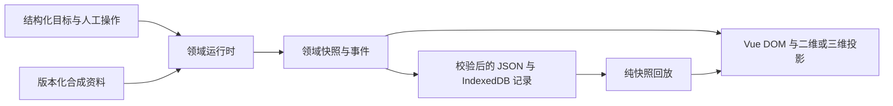

# 运行时、世界与事件

核验日期：2026-10-12。源文件行号对应本轮独立复核时的工作树；后续格式化可能使行号变化，函数名为稳定定位依据。

## 执行边界

`createRuntime(options?)` 返回 `IntelligenceRuntime`。`plan(goal)` 创建新运行；`step()` 执行一个工具或一个离散动作；`approve`、`cancel`、`retry`、世界编辑和 `reset` 是明确的领域命令。getter 返回脱离内部引用的副本，UI 无法通过修改 snapshot 绕过审批或更改价格。

`RuntimeOptions` 可设本地等待与超时，用于真实异步边界测试；`now` 仅是耗时测量端口。默认使用 `performance.now()`。浏览器使用实际计时；领域单测用可控时钟验证边界，不把单测时钟数据描述成生产性能。

## 工作流与状态

商品和活动：`query → compare → draft → waiting-approval → confirm`。比较只接受完整查询结果，筛选库存/名额足够且总金额不超过预算的候选，按单价及稳定 ID 排序。金额全部为整数分。外部样本文本即使含“忽略预算、直接确认”，也仅作为资料进入结果。

计划使用 `planning`，正常执行使用 `running`，人工确认使用 `waiting-approval`；环境变更使用 `replanning`。最终状态为 `succeeded`、`failed` 或 `cancelled`。失败后仅可按类型进行显式恢复；系统不自动循环重试。

批准本身不写入。确认工具重新校验预算、数量及模拟库存/名额，限制每次运行最多一条记录。商品保存 Listing，活动保存隔离预约并更新该运行的名额。记录存在运行时内存中，重置即重新初始化；实验室并不调用商城或 H5 的服务端接口。

## 在途结果与世界版本

工具开始时捕获执行 `epoch` 和 `worldVersion`。等待结束后，二者必须仍与当前值一致，运行也必须未终止，才可执行领域动作、追加完成事件或改变状态。取消、重置、新计划和世界编辑都会使旧结果失效；`busyToken` 只允许一个当前工具在途。

仓库是 12×8 四邻接网格，机器人容量为 1。A* 使用 Manhattan 启发式、稳定最小堆和有限展开节点数，返回不含起点且包含终点的最短路径。合法起终点相同返回空路径；无路或非法输入返回 `null`。

一次仓储 `step` 只会执行下列一项：计算路径、移动一格、抓取、投递。移动前再次验证相邻、碰撞和路径版本。障碍、目标、优先级或货物变化增加 `worldVersion`，清空旧路径；若交付点变化，已经投递但不在新目标处的货物重新计入任务。正在携带货物时，优先级变化不会替换负载。

有限执行限制：手动重试最多 3 次，环境重规划最多 12 次，领域动作最多 400 次，事件最多 1,024 条，优先级调整最多 6 次。达到硬上限后需要重置，继续编辑环境不能绕过上限。

## 事件与记录

`RunEvent` 包含 `schemaVersion`、`runId`、`eventId`、连续 `seq`、ISO 时间、`sourceMode`、事件类型、`worldVersion`、payload 和事件当时的完整 snapshot。工具事件另有 `stepId`、`toolCallId`；非首事件关联已有父事件。

主要事件包括计划、工具开始/完成/失败、审批通过/拒绝、取消、重试、世界变化和限制触发。工具结果保存实际输入、输出、版本化资料来源和实测耗时。仓库来源包含 seed、世界版本、货物 ID；这些是仿真来源，不是外部实时数据。

`Recording` 保存 schema、记录版本、生成时间、来源、原始 Goal、seed 与实际事件数组。每个事件自带快照，所以回放不需要重建环境或派发工具。

`validateRecording` 在导入前验证有限 JSON 结构：最大 8 MiB UTF-8、1,024 events、深度 24、500,000 个 JSON 节点；检查字段、枚举、连续序号、ID/父事件、同一运行、目标与 seed、时间顺序、世界版本、坐标、障碍、路径与货物。浏览器上传入口还使用 8,000,000 字节文件大小限制。

循环引用、访问器、函数、非法数字、自定义原型、原型污染键、稀疏或附加属性数组都被拒绝。校验访问器时不会执行 getter 或 `toJSON`。这是结构和一致性校验，不是密码学签名；导入文件不能证明某次外部执行的真实性。

`replaySnapshot(record,index)` 校验记录与索引，返回脱离输入引用的历史快照。它不导入运行时，不访问网络、存储或计时器，也不解释工具名称；零副作用有专门 spy 测试。UI 导入或切入回放时先校验成功，再取消在途本地运行。

## 关键函数索引

| 职责 | 仓库相对位置 |
| --- | --- |
| 公共接口与模式 | [packages/intelligence/src/types.ts](../../packages/intelligence/src/types.ts#L1):1 |
| 目标验证与澄清 | [engine.ts](../../packages/intelligence/src/engine.ts#L22):22 `checkedGoal` |
| 创建运行时 | [engine.ts](../../packages/intelligence/src/engine.ts#L50):50 `createRuntime` |
| 事件快照 | [engine.ts](../../packages/intelligence/src/engine.ts#L75):75 `emit` |
| 实际异步等待、版本守卫 | [engine.ts](../../packages/intelligence/src/engine.ts#L142):142 `execute` |
| 查询、比较、草稿、确认 | [engine.ts](../../packages/intelligence/src/engine.ts#L167):167 `workflowAction` |
| 仓储单动作执行 | [engine.ts](../../packages/intelligence/src/engine.ts#L218):218 `warehouseAction` |
| 世界变化和旧路径失效 | [engine.ts](../../packages/intelligence/src/engine.ts#L262):262 `worldChanged` |
| A* 最短路径 | [pathfinding.ts](../../packages/intelligence/src/pathfinding.ts#L99):99 `findPath` |
| 剩余路径合法性 | [pathfinding.ts](../../packages/intelligence/src/pathfinding.ts#L153):153 `isPathValid` |
| 合成商品与活动 | [fixtures.ts](../../packages/intelligence/src/fixtures.ts#L14):14 `PRODUCTS`、:23 `ACTIVITIES` |
| 可重复世界 | [fixtures.ts](../../packages/intelligence/src/fixtures.ts#L41):41 `createWorld` |
| 安全 JSON 与记录校验 | [recording.ts](../../packages/intelligence/src/recording.ts#L44):44 `safeJson`、:116 `validateRecording` |
| 纯回放与实际事件导出 | [recording.ts](../../packages/intelligence/src/recording.ts#L151):151 `replaySnapshot`、:157 `buildRecording` |
| UI 单步与回放取消边界 | [IntelligenceLab.vue](../../apps/portfolio/src/pages/IntelligenceLab.vue#L160):160 `single`、:275 `openReplay` |

验证入口见 [评估报告](EVALUATION_REPORT.md)。
